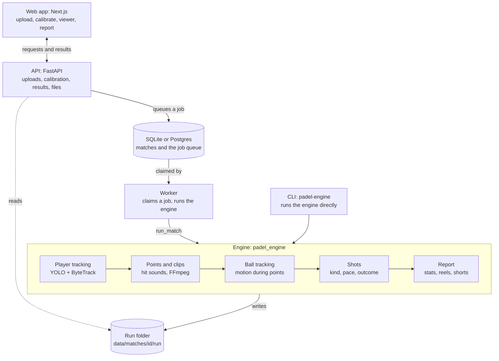

# Padel Buddy

Upload a long padel match video and get the rallies cut into clips, a
highlight reel, player movement stats, ball tracking, shot and mistake
analysis with a written report, and each player's own highlights and numbers
across matches.

It starts as a personal tool and is built so the same engine can serve a web
app, phones, an Android app and a desktop app.

## Status

| Step | What | State |
| --- | --- | --- |
| 1 | Court mapping and player tracking | Built, awaiting real footage ([engine/](engine/)) |
| 2 | Rally detection, clips (±30 s around intense moments) and highlights | Built, awaiting real footage |
| 3 | API, job queue and storage | Built ([api/](api/)) |
| 3 | Web app (desktop and phone browsers) | Built ([web/](web/)) |
| 4 | Ball tracking, shots, how points ended, match report, success rate per shot, per-player highlights and winners, shorts, a clip per point | Built, awaiting real footage |
| 5 | Pose (forehand / backhand, technique), automatic court detection | Later |

## Architecture



One Python engine does all the video work, and every client talks to it
through the same API. Each engine stage reads the files the stage before it
wrote and adds its own to the match's run folder:

| Stage | Module | Writes |
| --- | --- | --- |
| Calibration | `calibration`, `court` | `calibration_check.jpg` |
| Player tracking | `detection`, `players`, `analytics`, `pipeline` | `tracks.csv`, `overlay.json`, `summary.json`, `heatmaps/` |
| Points and clips | `audio`, `events`, `clips` | `hits.csv`, `clips.json`, `clips/`, `highlights.mp4`, `condensed.mp4`, `points/` |
| Ball tracking | `ball` | `ball_track.json`, `ball.json` |
| Shots | `shots` | `shots.json` |
| Report | `report`, `shorts`, `coach` | `report.json`, `report.md`, `players/`, `shorts/` |

See [docs/architecture.md](docs/architecture.md) for the design choices.

## Quick start

```bash
cd engine
python -m venv .venv && source .venv/bin/activate
pip install -e ".[detect,calibrate,dev]"   # install PyTorch for your GPU first

padel-engine calibrate path/to/match.mp4 --out data/calibration.json
padel-engine analyze path/to/match.mp4 -c data/calibration.json --out runs/match1
```

Details in [engine/README.md](engine/README.md).

To use it from a browser instead: run the API and a worker
([api/README.md](api/README.md)), then the web app ([web/README.md](web/README.md)).

## Repository rules

This repository is public. Keys go in a local `.env` (git-ignored; copy
`.env.example`). Videos, run outputs and model weights are git-ignored too;
keep them under `data/` and `runs/`.
